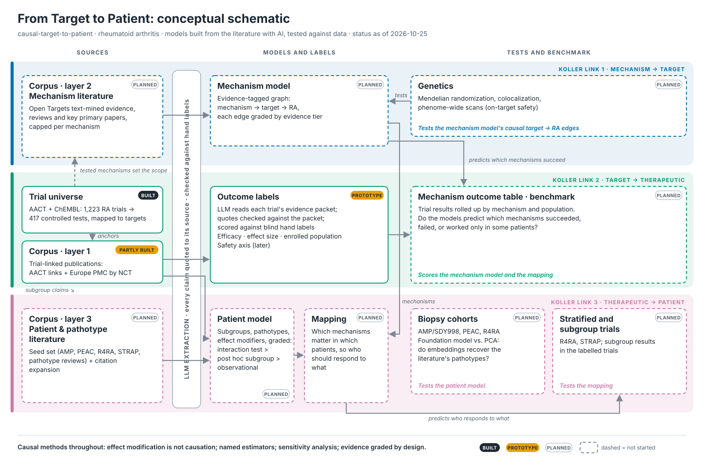

# From Target to Patient

### Causal Methods Across Therapeutic Discovery and Development

Drug discovery and development is a chain of causal questions, for therapeutics of any modality. Following Daphne Koller's framing, the chain has three links, and each can fail:

1. **Mechanism → target.** Is this target a causal driver of disease, or a bystander? A literature-derived mechanism model, with every edge graded by the kind of evidence behind it, is tested using human genetics (Mendelian randomization, colocalization).
2. **Target → therapeutic.** Does intervening on the target produce the intended effect? Genetic variants that mimic lifelong target perturbation serve as natural experiments. Their predictions are benchmarked against what randomized trials later showed for approved and failed therapeutics.
3. **Therapeutic → patient.** Which patients' disease runs through that mechanism, and who will respond? Two things are tested against synovial tissue cohorts and against published trial results stratified by patient subgroup:
   - a patient model of clinical phenotypes and endotypes
   - the mapping between mechanism and patient

The first disease is rheumatoid arthritis (RA).



## Status (2026-10-25)

This is work in progress, built in the open. What exists today:

- **Trial universe (built).** The pipeline:
  - pulls RA trials from AACT (ClinicalTrials.gov as a database)
  - maps each tested intervention to its molecular targets through ChEMBL
  - classifies what each trial compares at the target level

  The result is 1,223 eligible trials. 825 are phase 1/2 to phase 3 trials that are no longer running (the labelling set), and 417 of those test a contrast between targets.
- **Curation with provenance (built).** ChEMBL can't map some names: development codes, misspellings, biosimilars, cell therapies. Those judgements live in hand-edited files under `curated/trials/`:
  - Every row records its source, a verbatim quote, a confidence and the curation batch that added it.
  - The test suite fails on any row without provenance.
  - Each batch has a log in [`docs/curation/`](docs/curation/) covering method, decisions, corrections and its measured effect.

  Five batches so far took the unmapped labelling trials from 220 to 52. They also set aside trials outside an efficacy benchmark: complications such as lung disease, vaccine responses, imaging studies, and trials whose primary endpoint isn't efficacy.
- **Outcome labelling (prototype).** The prototype does three things:
  - builds an evidence packet for each trial: registered design and eligibility, posted results, linked publications, stop reason
  - asks an LLM for a structured label: the outcome, the enrolled population, the effect against control, and per-dose results
  - checks that the quoted evidence and the effect numbers actually appear in the packet

  The rules, including how multi-dose trials are labelled, are in [`docs/labelling.md`](docs/labelling.md). A 20-trial development set, stratified by evidence tier, is labelled and awaiting hand labels. A blind test set comes next.

What's next, each as a public write-up:
1. Scoring the outcome labels against hand-labelled trials.
2. A mechanism-evidence model for a slice of about 10 mechanisms, set against trial outcomes.
3. A patient model of graded subgroup claims, checked against stratified trials (R4RA, STRAP).
4. An end-to-end result: mechanism → patient on that slice.

### Open questions

- Conditioning agents are counted as tested drugs. One example is fludarabine before a CAR-NK therapy in NCT06733935. Fixing this needs trial-specific roles.
- Some extension studies and sequential-therapy trials are still misclassified. They are listed for review.
- Leakage: a literature-built model may already "know" how trials turned out. The plan is to build each mechanism's corpus only from papers published before the relevant trial read out.

## Getting started

Requires Python 3.12+ and a free [AACT account](https://aact.ctti-clinicaltrials.org/users/sign_up).

```bash
pip install -e ".[dev]"
cp .env.example .env        # add AACT_USER and AACT_PASSWORD
pytest -q tests
```

Optional keys in `.env`:
- `ANTHROPIC_API_KEY` for outcome labelling
- `NCBI_API_KEY` for faster PubMed requests

The pipeline writes dated outputs (`*_YYYYMMDD.csv`) to a data directory outside the repository:

```bash
D=../causal-data/aact
python scripts/pull_ra_trials.py --out-dir $D              # trial universe from AACT
python scripts/map_ra_interventions.py --data-dir $D       # interventions -> ChEMBL targets -> contrast classes
python scripts/curation_worklist.py --data-dir $D          # what still needs curating
python scripts/check_evidence_availability.py --data-dir $D
python scripts/build_evidence_packets.py --data-dir $D --nct-ids NCT00413660
python scripts/label_trials.py --data-dir $D --nct-ids NCT00413660
```

## Repository layout

| Path | Contents |
|---|---|
| `src/causal_target_to_patient/sources/` | AACT, ChEMBL and PubMed access |
| `src/causal_target_to_patient/labelling/` | Evidence packets and LLM extraction |
| `src/causal_target_to_patient/curation.py` | Provenance checks and the curation worklist |
| `scripts/` | Pipeline steps and diagnostics |
| `curated/trials/` | Hand-curated mappings, exclusions and decisions, with provenance |
| `docs/curation/` | Curation rules and one log per batch |
| `tests/` | Unit tests, plus provenance checks on the curated files |

## Data

No trial data is stored in this repository. AACT and ChEMBL are queried at run time, and responses are cached locally outside the repository.

## License

MIT
